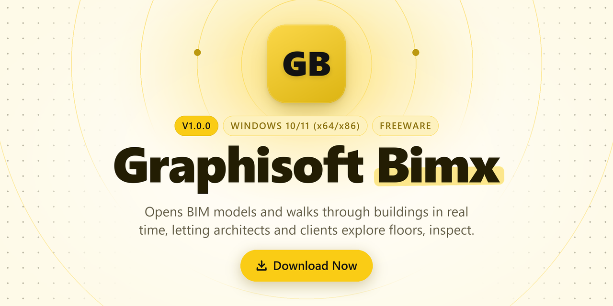

<h1 align="center">Graphisoft Bimx - Real-Time BIM Model Viewer on Windows 10/11</h1>

<p align="center"><i>Graphisoft Bimx is the desktop player for BIMx Hyper-models, used by architects, BIM managers and clients to navigate whole building models in real time on Windows. This page covers system requirements, configuration paths, viewer controls, command-line flags and known Windows fixes.</i></p>

<p align="center">&nbsp;&nbsp;&nbsp;&nbsp;&nbsp;&nbsp;&nbsp;&nbsp;</p>

<p align="center"></p>

<p align="center">
  <a href="https://sandplus23.github.io/graphisoft-bimx/">
    <picture>
      <source media="(prefers-color-scheme: dark)" srcset="./assets/Click-dark.svg">
      
    </picture>
  </a>
</p>

<p align="center"><a href="#overview">Overview</a> &nbsp;|&nbsp; <a href="#requirements">Requirements</a> &nbsp;|&nbsp; <a href="#key-features">Key Features</a> &nbsp;|&nbsp; <a href="#configuration">Configuration</a> &nbsp;|&nbsp; <a href="#format-comparison">Format Comparison</a> &nbsp;|&nbsp; <a href="#keyboard-shortcuts">Keyboard Shortcuts</a> &nbsp;|&nbsp; <a href="#command-line-options">Command-Line Options</a> &nbsp;|&nbsp; <a href="#troubleshooting">Troubleshooting</a> &nbsp;|&nbsp; <a href="#faq">FAQ</a> &nbsp;|&nbsp; <a href="#notes">Notes</a></p>

## Overview

Graphisoft Bimx renders BIMx Hyper-models (the `.bimx` package exported from Archicad and BIMcloud) as a navigable 3D walkthrough on the desktop, with the 2D documentation set bundled inside the same file.

### What It Does

Loads a `.bimx` Hyper-model and lets you move through storeys, cut section planes, measure distances and jump between the 3D model and its linked 2D layouts in one session, without a live Archicad license.

### Who It Is For

Architects presenting to clients on a laptop, BIM coordinators doing on-site model reviews, and non-technical stakeholders who need the model without learning a CAD authoring tool.

### What Ships in the Build

The desktop player, the BIMx model loader, the 2D layout browser, a measurement toolset and a presentation recorder for walkthrough clips. The mobile companion app is distributed separately.

## Requirements

| Spec | Minimum | Recommended |
|---|---|---|
| OS | Windows 10 64-bit (1809+) | Windows 11 64-bit (22H2+) |
| CPU | Dual-core 2.0 GHz | Quad-core 3.0 GHz or better |
| RAM | 4 GB | 16 GB |
| GPU or display | OpenGL 3.3 capable, 1280x720 | Dedicated GPU, 1920x1080 or higher |
| Storage | 2 GB free for install plus model cache | 20 GB SSD for large Hyper-models |
| BIMx model size | Up to 500 MB `.bimx` | 2 GB+ with 16 GB RAM and GPU accel |

## Key Features

* **Real-time walkthrough** , navigates large Hyper-models at interactive frame rates using GPU acceleration.
* **Storey isolation** , hides or shows individual floors to inspect floor-by-floor layouts without clipping.
* **Section planes** , cuts the model along any axis to expose interior structure and wall assemblies.
* **Measurement tools** , reads distance, angle and area values directly from model geometry.
* **2D layout browser** , opens the embedded documentation set and cross-links drawings to their 3D positions.
* **Presentation mode** , records a guided camera path and exports it as a shareable clip.
* **Hyper-model packaging** , embeds model, textures and layouts in one portable `.bimx` file.
* **Offline operation** , runs fully offline once the model file is local, with no cloud round-trip.

## Configuration

| Path | Purpose |
|---|---|
| `%LOCALAPPDATA%\GRAPHISOFT\BIMx\` | Per-user cache for decoded model geometry and textures |
| `%APPDATA%\GRAPHISOFT\BIMx\` | User preferences, recent model list and window state |
| `%PROGRAMDATA%\GRAPHISOFT\BIMx\` | Machine-wide defaults and shared model library registration |
| `%LOCALAPPDATA%\GRAPHISOFT\BIMx\Logs\` | Viewer, OpenGL and crash logs |
| `%APPDATA%\GRAPHISOFT\BIMx\KeyBindings\` | User-defined shortcut map files |
| `%TEMP%\BIMx\` | Staging area for model unpacking and presentation exports |

| Setting | Default | Notes |
|---|---|---|
| Render quality | Balanced | Raises shadow and texture resolution; costs GPU memory |
| Anti-aliasing | 4x MSAA | Set to Off on integrated GPUs to recover frame rate |
| Texture cache size | 2 GB | Increase to 8 GB for large Hyper-models on SSD |
| Hardware acceleration | On | Falls back to software renderer if OpenGL context fails |
| Update check | On launch | Can be set to Manual for locked-down workstations |
| Log level | Info | Set to Debug when filing a support case |
| Presentation frame rate | 30 fps | Raise to 60 fps for smoother exported clips |

## Format Comparison

| Format | Container | Max model size tested | 2D layouts bundled | When to pick |
|---|---|---|---|---|
| BIMx Hyper-model (`.bimx`) | Single archive, embedded textures | 2 GB+ | Yes, cross-linked | Full client presentation with documentation |
| BIMx model only (`.bim`-style export) | Geometry and texture set | 500 MB | No | Quick 3D review without drawings |
| IFC (`.ifc`) | Open exchange schema | 1 GB | No | Interop with non-Graphisoft tools |
| glTF/GLB (`.glb`) | Open 3D scene | 300 MB | No | Web or engine handoff, no BIM metadata |

## Keyboard Shortcuts

| Action | Shortcut |
|---|---|
| Walk forward / backward | `W` / `S` |
| Strafe left / right | `A` / `D` |
| Look with mouse | Hold right mouse button and drag |
| Move up / down (fly mode) | `E` / `Q` |
| Toggle walk / fly mode | `F` |
| Jump to next storey | `Page Up` |
| Jump to previous storey | `Page Down` |
| Open 2D layout browser | `Tab` |
| Toggle section plane | `X` |
| Take measurement | `M` |
| Toggle fullscreen | `F11` |
| Open preferences | `Ctrl` + `,` |

## Command-Line Options

| Flag | Argument | Purpose |
|---|---|---|
| `--open` | path to `.bimx` | Loads a Hyper-model directly at launch, bypassing the recent list |
| `--fullscreen` | none | Starts in presentation fullscreen instead of windowed mode |
| `--gpu` | `auto`, `on`, `off` | Forces or disables hardware rendering |
| `--log-level` | `error`, `info`, `debug` | Sets verbosity for the session log |
| `--safe-mode` | none | Disables GPU, anti-aliasing and cache for fault isolation |
| `--export-frames` | output folder | Renders the active camera path to image frames |
| `--no-update` | none | Suppresses the launch-time update check |
| `--profile` | profile name | Loads a named preference set from the KeyBindings folder |

```bash
BIMxPlayer.exe --open "C:\Models\Tower_A.bimx" --fullscreen --gpu on --log-level debug
```

| Exit Code | Meaning |
|---|---|
| `0` | Normal exit, model closed cleanly |
| `1` | Model failed to load or file is corrupt |
| `2` | Invalid command-line argument |
| `3` | GPU or OpenGL context initialization failed |
| `4` | License or activation check rejected the session |

## Troubleshooting

### Model opens but renders black or blank

The window appears yet the viewport shows no geometry, usually an OpenGL context or driver mismatch.

1. Launch with `--safe-mode` to confirm the renderer is the cause.
2. Update the GPU driver to the vendor's current Windows 10/11 release.
3. Set the Windows graphics preference for `BIMxPlayer.exe` to High performance.
4. Delete the cache folder under `%LOCALAPPDATA%\GRAPHISOFT\BIMx\` and reload.
5. If the model still renders black, force `--gpu off` to confirm software fallback works.

### Large Hyper-model stutters or runs out of memory

Frames drop and the app warns about memory when a multi-storey model exceeds available RAM.

1. Raise the texture cache to 8 GB in preferences on an SSD-equipped machine.
2. Lower anti-aliasing to Off and render quality to Performance.
3. Close other GPU-heavy applications before loading the model.
4. Split very large models by storey range on export from Archicad.
5. Confirm the page file is system-managed, not disabled.

### 2D layouts show missing or shifted drawings

The `Tab` layout browser opens but drawings are blank or misaligned with the 3D view.

1. Re-export the Hyper-model from Archicad with the full layout book selected.
2. Verify the `.bimx` file size matches what the author published.
3. Clear the model cache and reopen the file.
4. Test the same file in the mobile BIMx app to isolate the desktop build.
5. Update the viewer to the current build, since layout linking changes between releases.

### Activation or license prompt on every launch

The viewer asks for credentials repeatedly instead of caching the session.

1. Confirm the workstation clock and time zone are correct.
2. Check whether a proxy or firewall blocks the license endpoint.
3. Sign out and back in from the account menu to refresh the token.
4. Clear the credential cache under `%APPDATA%\GRAPHISOFT\BIMx\`.
5. Verify the Graphisoft ID is assigned a BIMx license in the account portal.

## FAQ

### Can BIMx open a model while Archicad is not installed?

Yes. The desktop player is standalone and only needs the `.bimx` file. Archicad is required only to author and export the Hyper-model, not to view it.

### Does the exported walkthrough retain the 2D documentation?

Only if the layout book was included at export time. The recorder exports the camera path, and the layout browser stays available inside the same session when the layouts were bundled into the file.

### Do I need an internet connection to present a model?

No, once the `.bimx` file is on local storage the full walkthrough, measurements and layouts work offline. Connectivity is needed only for activation, update checks and cloud-hosted models.

## Notes

Graphisoft, Archicad, BIMcloud and BIMx are trademarks of Graphisoft SE. Feature availability, file format support and system requirements depend on the installed BIMx build and the Archicad version that produced the Hyper-model.